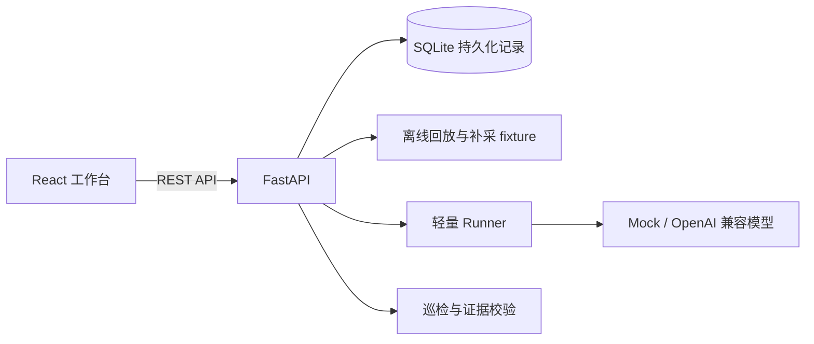

# 声量观测台

AI 数据采集与分析工作台 MVP。当前实现覆盖测试数据导入、业务任务总览、任务详情追溯、Mock/Live 分析入口和异常巡检。平台回答数据由用户提供的数据包导入；应用不会主动抓取第三方平台。

## 本地运行

需要 Node.js 20+ 和 Python 3.11+。

```powershell
python -m venv .venv
.venv\Scripts\Activate.ps1
pip install -r requirements.txt
uvicorn backend.app:app --reload --port 8000
```

另开终端启动前端：

```powershell
npm install
npm run dev
```

打开 Vite 输出的本地地址。SQLite 文件默认保存在 `data/workbench.sqlite3`，可通过 `WORKBENCH_DB` 修改。

后端流程测试：`python -m unittest discover -s tests -v`。浏览器桌面/手机冒烟测试：`npm run test:browser`（需要本机已安装 Microsoft Edge）。

## 导入数据

点击“加载测试数据”并直接选择数据包 ZIP，或选择其中的 `seed_all.json`。导入模式可选“合并导入”或“替换数据集”：合并会按数据主键更新并保留其他记录；替换会在一个数据库事务内清空当前业务记录、取消排队作业并导入新批次。替换操作会再次确认。每次导入会保留批次模式、记录数和时间。

当前已导入题目提供的模拟数据包。导入器识别 `connectors`、`assets`、`intents`、`expected_tasks`、`task_attempts`、`collection_records`、`analysis_results`、`metric_snapshots` 和 `recovery_fixtures`。

## AI 模式

重新解析默认走 Mock，并在分析记录中写入 `mode=mock`。配置 `OPENAI_API_KEY`、`OPENAI_BASE_URL` 和 `OPENAI_MODEL` 后，可从任务详情发起 Live 调用。两种模式都会校验必需字段、证据原文和来源链接；校验失败会保留失败状态。

本次交付环境未配置 `OPENAI_API_KEY`，因此没有执行真实模型 API 调用。演示中应把重新解析明确称为 Mock，不得把种子结果描述成 Live 输出。Live 调用重试仅覆盖网络错误、超时、HTTP 408/425/429 和 5xx，最多 3 次，按 1 秒、2 秒退避；其他错误保留失败状态供人工处理。

## 当前实现范围

- 已实现：ZIP/JSON 导入、主键/业务键/引用关系和 manifest 记录数校验、合并/替换批次、SQLite 持久化、分页任务列表、按 T+2 截止时间巡检、目标资产范围内的 Mock 解析、证据校验、重启恢复和退避重试的后台作业、统计快照核对及基于 recovery fixture 的补采。
- 当前限制：后台作业由应用进程串行处理，适用于本地笔试演示；大规模运行需替换为外部队列和多 Worker。
- 后续建议：增加认证与租户隔离；部署规模上升后将 SQLite 换为 PostgreSQL，并将 Runner 接入队列。

## API

- `POST /api/v1/seed/import`
- `POST /api/v1/seed/import-archive?mode=merge|replace`
- `GET /api/v1/overview`
- `GET /api/v1/dataset`
- `GET /api/v1/tasks`
- `GET /api/v1/tasks/{task_key}`
- `POST /api/v1/inspections`
- `POST /api/v1/reanalyze?task_key=...`
- `POST /api/v1/retry?task_key=...`
- `GET /api/v1/runs/{run_id}`

## AI 开发工具说明

AI 工具用于方案拆解、代码起草和实现核对。提交前应人工检查 API 的业务键关联、导入事务、证据校验、异常恢复和浏览器交互，并用题目提供的数据包验证异常数量及有效完成数。

演示录制步骤和旁白要点见 [docs/demo-script.md](docs/demo-script.md)。

录制本地字幕版 WebM 需要 Microsoft Edge 和 Playwright ffmpeg：先运行 `npx playwright install ffmpeg`，再在独立终端启动临时 API 和前端代理，避免覆盖工作台当前数据库：

```powershell
$demoDb = Join-Path $env:TEMP 'ai-workbench-demo.sqlite3'
$env:WORKBENCH_DB = $demoDb
uvicorn backend.app:app --port 8001
```

```powershell
$env:API_PROXY_TARGET = 'http://127.0.0.1:8001'
npm run dev -- --host 127.0.0.1 --port 5174
```

然后录制：

```powershell
$env:DEMO_URL = 'http://127.0.0.1:5174/'
npm run demo:record
```

默认输出为 `artifacts/声量观测台演示.webm`。当前字幕版录屏时长约 5 分 38 秒、1440×900，无语音旁白。可用 `DEMO_DATA_ZIP`、`DEMO_URL` 和 `DEMO_VIDEO_OUT` 覆盖输入数据包、页面地址和输出位置。录制脚本会使用“替换数据集”将目标演示数据库重置为 ZIP 中的基准数据。

## 架构与扩展说明

当前 MVP 的数据路径如下：



扩展至每天 10 万条逻辑任务时，可将平台接入拆为独立 Connector，将分析与补采交给带重试和死信处理的队列 Worker；按业务日期、租户和业务键为 PostgreSQL 建索引，前端使用服务端筛选、分页和预聚合指标。当前规模继续使用 SQLite 和轻量 Runner，避免过早引入 Kubernetes、搜索集群和复杂编排。

正式多租户部署时，API 通过 JWT 识别用户和租户，角色授权在接口层执行；数据访问层对每个查询强制附带 `tenant_id`，业务唯一键包含租户边界。API 以 `/api/v1` 版本化；新增字段保持可选，破坏性变更再新增 `/api/v2`。这些认证和隔离机制尚未在本地演示版启用。

示例任务查询：

```http
GET /api/v1/tasks?asset_id=a01&platform=ChatGPT&business_date=2026-11-20
```

```json
{
  "items": [{
    "task_key": "a01|ChatGPT|2026-11-20",
    "status": "有效完成",
    "attempt_count": 1,
    "valid": true
  }],
  "total": 1,
  "page": 1,
  "page_size": 20
}
```

完整性核对以 `expected_tasks` 为全集，按 `(asset_id, platform, business_date)` 去重，再检查是否存在可追溯的原始回答和通过校验的分析结果。重试保留 attempt 历史，但不得增加逻辑任务数；同一任务已有 queued/running attempt 时复用该运行记录。T+2 截止前对缺失、失败、卡住和证据不一致任务生成巡检项，并从 fixture 补采。统计快照按品牌、平台和业务日期重算应有数、有效完成数与提及率，再和导入的快照对账。选择单个产品时跳过品牌级快照比较，避免把部分产品误当成整个品牌。
